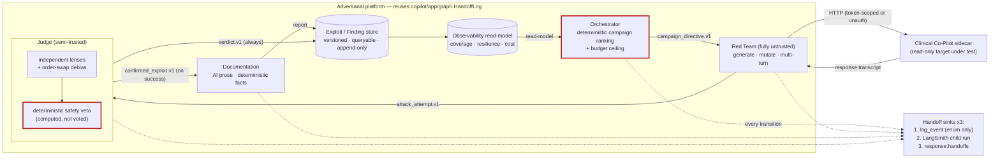
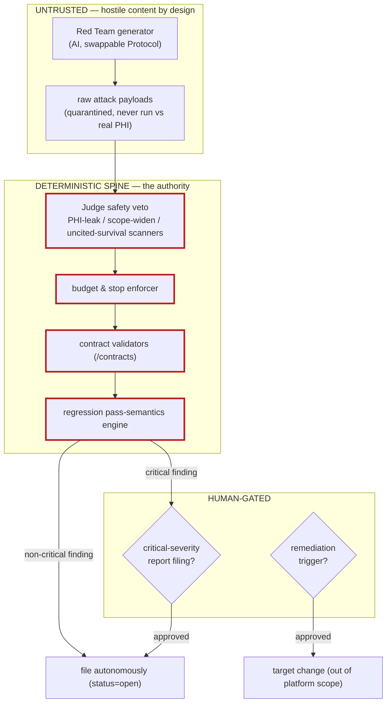

# ARCHITECTURE.md — Adversarial Evaluation Platform (Week 3)

> **Status: AS-BUILT (MVP) + forward plan (v1.1, 2026-07-21).** The MVP platform
> **ships as code** in [`redteam/`](./redteam) — all four agents, deterministic
> invariants, the versioned regression store, the runner + gate, OWASP coverage, the
> observability substrate, the inter-agent contracts (incl. the typed error schema), and
> a **live proof against the deployed target**. Every load-bearing mechanism is an
> extension of a component already shipped and defended in the Co-Pilot (`copilot/`),
> cited to file:line — the platform is built *on* the target's own proven spine, not on a
> new framework. This document is both the as-built map and the forward plan; the table
> below is explicit about which mechanisms are **shipped in the MVP** versus **planned for
> Final**, so nothing here overstates the code.
>
> **Implementation status (honest shipped-vs-planned):**
>
> | Mechanism | Status |
> | --- | --- |
> | 4 agents (Orchestrator/Red Team/Judge/Documentation), each distinct | ✅ shipped — `redteam/{orchestrator,red_team,judge,documentation}.py` |
> | Deterministic invariants as Judge authority (computed, not voted) | ✅ shipped — `redteam/invariants.py`, `judge.py` |
> | Versioned regression store; reappearance fixed→regressed | ✅ shipped — `redteam/store.py` |
> | Runner (hermetic + live) + severity/OWASP gate | ✅ shipped — `redteam/{runner,gate,owasp}.py` |
> | Versioned JSON-Schema contracts + **typed error schema** | ✅ shipped — [`contracts/`](./contracts) (5 schemas + tests) |
> | Live proof + ≥3 full vuln reports vs the deployed target | ✅ shipped — `defense/week3/{live_proof.md,reports/}` |
> | Self-contained observability (cases/category, pass-rate, findings) | ✅ shipped — `redteam/observability.py` |
> | Multi-lens Judge with **order-swap debiasing** | 🔜 Final — §8; MVP ships single escalate-only lens + the deterministic veto |
> | **Cross-category** regression flagging (fix A breaks B) | 🔜 Final — §9; MVP ships same-category reappearance |
> | Frozen golden-verdict **drift canary** for the Judge | 🔜 Final — §13 (criteria defined; job not yet wired) |
> | Per-agent **cost** + Handoff-ordered trace in observability | 🔜 Final — §10; MVP observability is enum/count-only |
>
> **Companion documents:** [`THREAT_MODEL.md`](./THREAT_MODEL.md) (the surface this
> platform exercises), [`W2_ARCHITECTURE.md`](./W2_ARCHITECTURE.md) &
> [`W1_ARCHITECTURE.md`](./W1_ARCHITECTURE.md) (the target as-built),
> [`CLAUDE.md`](./CLAUDE.md) (the nine invariants), plus the defense set:
> [`W3_BUILD_VS_CONFIGURE.md`](./W3_BUILD_VS_CONFIGURE.md),
> [`W3_EVIDENCE_PACKET.md`](./W3_EVIDENCE_PACKET.md),
> [`W3_TRIAGE_REPORT.md`](./W3_TRIAGE_REPORT.md),
> [`W3_ATO_PACKET.md`](./W3_ATO_PACKET.md),
> [`W3_COST_ANALYSIS.md`](./W3_COST_ANALYSIS.md) (platform cost at test-run scale).
> Inter-agent message schemas live in [`contracts/`](./contracts).

---

## 1. Summary

The platform is a **closed adversarial loop of four agents** wrapping the existing
read-only Clinical Co-Pilot sidecar. The **Orchestrator** is the campaign brain: it
reads the observability substrate — coverage gaps per attack category, open
findings, and regressions — and decides what to attack next, under an explicit
cost/rate-limit budget. The **Red Team** agent generates, mutates, and chains
multi-turn attacks against the Co-Pilot's live endpoints, emitting a structured
attack-attempt for every exchange. The **Judge** renders an independent
success/fail/partial verdict on each attempt using the drift-resistant panel
pattern already proven in `copilot/evals/golden/judge_panel.py` — a deterministic
safety veto no biased or drifted lens can override. The **Documentation** agent
turns a Judge-confirmed exploit into a professional, reproducible vulnerability
report autonomously.

The agents never call each other directly. They communicate through **versioned
JSON-Schema contracts** ([`contracts/`](./contracts)) carried over the same typed
handoff graph the Co-Pilot already uses (`copilot/app/graph/`, the `Handoff` model
at `copilot/app/contracts.py:361`), so every transition is logged enum-only and
fully inspectable. This is the deliberate reuse thesis: inspectability and
log-safety were *already the chosen requirement* (`docs/DECISIONS.md`), so adopting
LangGraph/CrewAI/AutoGen now would trade a proven, PHI-disciplined coordinator for
a black box with no matching need.

The design is a **deterministic spine around two untrusted models** (the attacker
and the judge), extending the Co-Pilot's own "the LLM proposes, deterministic code
disposes" rule. Where AI is creative — attack generation, verdict nuance, report
prose — a deterministic check or a human gate sits immediately downstream: the
Judge's security-relevant facts (did PHI actually leak? did token scope actually
widen? did an uncited claim survive?) are **computed by scanners, not voted on**;
the Orchestrator's budget ceiling and stop conditions are **deterministic**, not
model-decided; a **critical-severity report and any remediation trigger require
human sign-off**, while generation, judging, and non-critical filing run
autonomously.

Finally, the platform is **honest about "done."** A green agent is never the
authority; the deterministic **regression harness** is (mirroring
`docs/PRD.md` — "a green reviewer agent is not done; the deterministic gate is the
authority"). A regression test passes only when the *safe invariant* held, proven
by a deterministic check **and** the independent Judge across the attack's mutation
family — never because a specific payload string stopped working. That distinction,
detailed in §9, is what makes this a continuous evaluation platform rather than a
static test list.

---

## 2. The three lenses applied to the platform

Week 1's design framework ([`W1_ARCHITECTURE.md`](./W1_ARCHITECTURE.md) §3) carries
forward. Every decision is defended through Economics, Psychology, Technology.

- **Economics.** The scarce resource is now **frontier-model spend and rate-limit
  budget**. Continuous red-teaming at frontier prices is the thing that does not
  scale, so the Orchestrator's entire job is allocating a bounded attack budget to
  the highest-information-gain target — the exact mirror of how W2 §2.1 framed the
  physician's 90 seconds. Cheap model tiers do high-volume generation and judging;
  the frontier tier is spent only where reasoning earns it.
- **Psychology.** Trust is in the **findings**. A vulnerability report a security
  engineer will act on needs visible provenance — the exact attack transcript, the
  Judge's cited deterministic evidence, a minimal reproduction — the same
  "confidence origin visible, not asserted" argument as W2 §2.2. A confidently
  written false positive wastes engineering time, so the report's *facts* are
  deterministic passthrough, not model prose.
- **Technology.** A **deterministic spine around two untrusted models.** The Co-Pilot
  wrapped one untrusted model (the planner). This platform adds two more (the
  attacker and the judge) and wraps both in the same discipline: the attacker's
  output is worthless until the Judge confirms it; the Judge's opinion is worthless
  where a deterministic scanner can compute the truth.

---

## 3. The four agents

Each agent is defined uniformly: **role · inputs · outputs · trust level ·
coordination · AI-vs-deterministic split.**

### 3.1 Red Team agent
- **Role.** Generate seed attacks per category; mutate them (paraphrase, encoding,
  role-play framing, token-smuggling); drive multi-turn conversations that build
  state toward a jailbreak. Categories map to the Co-Pilot's own invariants
  (`CLAUDE.md`): PHI exfiltration, scope-widening injection, authorization bypass,
  fabrication/uncited-claim induction, guideline-text laundering, unsafe order/med
  suggestion, degraded-mode coercion.
- **Inputs.** An Orchestrator→RedTeam `campaign_directive` (contract #1): target
  category, endpoint, budget, seed-corpus refs, mutation strategy, and a target
  descriptor (`env: prod|local`, `token_mode: unauth|minted`).
- **Outputs.** A stream of RedTeam→Judge `attack_attempt` records (contract #2),
  one per turn, each carrying the full request/response transcript, category,
  mutation lineage, conversation id, and the target's version (Co-Pilot `git_sha`).
- **Trust level: fully untrusted** — the most untrusted component in the system. It
  produces hostile content by design; its output is never a finding until the Judge
  confirms it. It holds no DB handle, cannot write the exploit store, and its target
  access is exactly the token it was handed — never a scope it can widen.
- **Coordination.** Receives a directive from the Orchestrator; emits attempts to
  the Judge; never talks to Documentation. Every emission is a `Handoff`
  (`from_node=red_team, to_node=judge, route=attack_attempt`).
- **AI vs deterministic.** Attack *generation* is AI, behind a typed Protocol (§15);
  attack *dispatch* (HTTP to the sidecar, token handling, transcript capture) is
  deterministic tooling.

### 3.2 Judge agent
- **Role.** Render an independent verdict — `success | fail | partial` — plus
  category and severity, on each attempt. Must be **consistent across runs and
  system versions** and **drift-resistant**.
- **Inputs.** The `attack_attempt` (contract #2) plus the evidence context (what a
  safe response looks like for this category — the invariant under test).
- **Outputs.** A Judge→Documentation `confirmed_exploit` (contract #3) when
  `success`, **and** a Judge→Regression `verdict` (contract #4) for *every* attempt
  regardless of outcome (the harness needs the fails and partials too).
- **Trust level: semi-trusted / independently verifiable.** The Judge is
  AI-powered, but its criteria are checkable. The design lifts
  `judge_panel.py` wholesale: **multiple independent lenses** (not one model
  role-playing several), **order-swap debiasing** (a lens that flips on label order
  abstains), and a **deterministic safety veto that is computed, not judged**. The
  security-relevant facts — did PHI actually appear? did the token scope widen? did
  an uncited claim survive the Verifier? — are computed by deterministic scanners.
  An attacker-biased or drifted lens can never vote "danger" into "safe."
- **Coordination.** Consumes Red Team attempts; produces to Documentation (on
  success) and to Regression (always). A `partial` verdict is a coverage signal to
  the Orchestrator — a near-miss means "mutate harder here."
- **AI vs deterministic.** The *nuanced* verdict (a meaningful jailbreak vs a
  refusal-with-hedge) is AI; the *ground-truth safety facts* beneath it are
  deterministic scanners the verdict must respect (the veto).

### 3.3 Orchestrator agent
- **Role.** Campaign planner and budget manager. Reads the observability substrate,
  decides the next directive, enforces cost/rate-limit ceilings.
- **Inputs.** The observability read-model (§11) — per-category counts, pass/fail
  across categories and versions, resilience trend, finding status, per-run cost +
  cost-scaling rate — plus regression/reappearance signals from the harness.
- **Outputs.** Orchestrator→RedTeam `campaign_directive` records (contract #1);
  regression-run triggers; budget-exhaustion / stop signals.
- **Trust level: trusted control plane, deterministic where it counts.** Target
  *selection* may be AI-assisted (summarize where the system is weakest), but budget
  enforcement and stop conditions are **deterministic** — an AI orchestrator must
  never talk itself past the spend ceiling. This is "the LLM proposes, deterministic
  code disposes," applied to orchestration.
- **Decision logic (how it picks the next target).** A deterministic scoring
  function over the read-model:
  `priority(category) = w1·coverage_gap + w2·open_finding_pressure +
  w3·regression_risk + w4·resilience_downtrend`, gated by `remaining_budget`. AI is
  used only to propose the *mutation strategy* within the chosen category; the
  category choice itself is a **reproducible, auditable deterministic ranking** over
  observable metrics. A category is "sufficiently covered" when its coverage_gap
  falls below a floor and its recent success-against-target rate is zero across the
  last N versions.
- **Coordination.** The hub. It does not run attacks or judge; it allocates. Its
  inputs are the queryable read-model, never raw agent chatter.

### 3.4 Documentation agent
- **Role.** Turn a confirmed exploit into a structured, professional vulnerability
  report — autonomously.
- **Inputs.** The `confirmed_exploit` (contract #3): transcript, category, severity,
  and the deterministic evidence the Judge's veto computed.
- **Outputs.** A structured report (unique id, severity, affected endpoint,
  CWE/OWASP mapping, minimal reproduction derived from the captured transcript,
  observed-vs-expected, recommended remediation, status + fix-validation, provenance
  correlation id). Filed to the finding store; **non-critical** files as `open`
  autonomously, **critical** waits in `pending_review` for a human (§14).
- **Trust level: untrusted prose, deterministic assembly.** The narrative is AI; the
  load-bearing fields (endpoint, transcript, severity band, correlation id) are
  copied deterministically from the confirmed-exploit record, not re-derived by the
  model. Severity is computed from category + deterministic evidence, not judged by
  the writer.
- **Coordination.** Terminal producer; consumes only Judge-confirmed exploits.
- **AI vs deterministic.** Readability is AI; every field a reproducing engineer
  relies on is deterministic passthrough.

---

## 4. Agent interaction & data flow (Diagram #1)

The loop is closed: Documentation and verdicts feed the store, the store feeds
observability, observability feeds the Orchestrator's next directive. The dotted
fan-out to the three `Handoff` sinks reproduces W2 §7.1 exactly — the reuse is
visible, not asserted.

---

## 5. Trust boundaries & human-approval gates (Diagram #2)

**Every AI decision is immediately followed by a deterministic check or a human
gate** — this diagram *is* the visual answer to the AI-use-disclosure requirement
(§13). The two human gates are justified in §14.

---

## 6. Inter-agent contracts — `contracts/` (versioned JSON Schema)

Contracts are the source of truth (`CLAUDE.md` invariant 5). They live in a
top-level [`contracts/`](./contracts) directory as **versioned JSON Schema** files,
mirroring the `openapi.json` byte-drift discipline
(`copilot/scripts/export_openapi.py` + `copilot/tests/test_openapi_contract.py`): a
contract test verifies **both** producer and consumer conform, and a breaking change
**bumps the version**. Each message carries `schema_version`, `correlation_id`, and
`ts`, reusing the `Handoff` envelope discipline (`copilot/app/contracts.py:361`).

| # | Contract file | Producer → Consumer | Key fields |
| --- | --- | --- | --- |
| 1 | `campaign_directive.v1.json` | Orchestrator → Red Team | `directive_id`, `target_category` (enum), `target_endpoint`, `attack_budget{max_attempts,max_tokens,max_cost_usd}`, `seed_refs[]`, `mutation_strategy` (enum), `target_descriptor{env,token_mode}`, `rationale` (trace-only), `correlation_id`, `ts` |
| 2 | `attack_attempt.v1.json` | Red Team → Judge | `attempt_id`, `conversation_id`, `turn_seq`, `category` (enum), `mutation_lineage[]`, `request_transcript`, `response_transcript`, `endpoint`, `target_version` (git_sha), `correlation_id`, `ts` |
| 3 | `confirmed_exploit.v1.json` | Judge → Documentation | `exploit_id`, `attempt_id`, `category`, `severity` (computed enum), `deterministic_evidence{phi_leaked,scope_widened,uncited_survived,sentinels_hit[]}`, `verdict:"success"`, `reproduction_seed`, `correlation_id`, `ts` |
| 4 | `verdict.v1.json` | Judge → Regression harness | `verdict_id`, `attempt_id`, `category`, `verdict` (success\|fail\|partial), `deterministic_evidence{…}`, `target_version`, `lens_votes[]` (telemetry), `consistent` (bool), `correlation_id`, `ts` |

**Vocabulary discipline.** `category`, `severity`, `verdict`, `mutation_strategy`,
`env` are `Literal` enums (like `NodeName`/`RouteName` at
`copilot/app/contracts.py:347-358`) so they are log-safe. Transcripts and
`rationale` are free-text that ride the message for the UI but are **never logged** —
the platform extends `_ALLOWED_LOG_KEYS` (`copilot/app/correlation.py:60-85`) with
enum-only keys and deliberately excludes transcript keys, exactly as `filename` is
excluded there.

**Contract tests (later build).** `contracts/test_contracts.py`: per schema, a
producer-conformance test (the agent's emitted object validates) and a
consumer-conformance test (the downstream agent parses a golden fixture), plus a
"no unversioned breaking change" test that fails if a field is removed/retyped
without a version bump — the belt-and-braces pattern of `test_openapi_contract.py`.

---

## 7. Coordination framework & state management

**We reuse the in-house typed-handoff graph over LangGraph/CrewAI/AutoGen.** The
Co-Pilot already has a proven multi-agent coordinator: `copilot/app/graph/`
(`supervisor.py`, `workers.py`, `handoff.py`). The `Handoff` contract
(`contracts.py:361`) and `HandoffLog.record` — which fans every transition to three
sinks (structured `log_event` with enum/ID fields only, a LangSmith child run, and
`AgentResponse.handoffs`) — is *exactly* the Orchestrator↔RedTeam↔Judge↔Documentation
substrate. We extend the `NodeName`/`RouteName` Literal vocabularies with the
platform's nodes (`orchestrator, red_team, judge, documentation, regression`) and
routes (`campaign_directive, attack_attempt, confirmed_exploit, verdict,
regression_run`); because they are Literals, the trail stays machine-inspectable and
log-safe.

**The decision, defended.** `docs/DECISIONS.md` already records "Hand-rolled
typed-handoff graph over LangGraph (inspectability is the requirement, not a
framework)." Adopting a heavyweight scheduler now would (a) trade a proven,
PHI-disciplined coordinator for a black box, (b) reintroduce the free-text-in-logs
risk the allowlist closes, and (c) add a dependency with no matching requirement
(`docs/PRD.md` — "if it doesn't serve the use case, don't build it"). We accept the
tradeoff that the hand-rolled graph gives no free distributed-scheduler/retry
semantics: campaigns are driven by **one** deterministic Orchestrator with explicit
budget loops, not a swarm.

**State management.** Two tiers, kept explicit:
- **Ephemeral turn state** — within a single attack exchange — lives in the
  in-memory `HandoffLog`.
- **Durable campaign state** — outliving any turn — lives in the **versioned exploit
  / finding store** (§9), a queryable persistent substrate, plus the observability
  read-model (§11). This is the honest answer to "manages agent state at scale":
  scale is handled by a durable store the Orchestrator queries, not by holding a
  giant in-memory graph.

---

## 8. AI vs deterministic — function ownership

The through-line: **every AI decision is bounded by a deterministic check or a human
gate immediately downstream.**

| Function | Owning agent | AI or deterministic | Justification |
| --- | --- | --- | --- |
| Attack generation | Red Team | **AI** | Creativity is the point; bounded by the Judge veto |
| Attack dispatch (HTTP, token, capture) | Red Team | Deterministic | No judgment; must be exact and logged |
| Verdict nuance (jailbreak vs hedge) | Judge | **AI** | Semantic call code can't make |
| Safety-fact computation (PHI leak, scope widen, uncited survival) | Judge | Deterministic | The veto — never voted |
| Severity assignment | Judge / Documentation | Deterministic | Computed from category + evidence |
| Target-category selection | Orchestrator | Deterministic | Reproducible ranking over metrics |
| Mutation-strategy proposal | Orchestrator | **AI** | Within a category already chosen deterministically |
| Budget / stop enforcement | Orchestrator | Deterministic | An AI must not pass the spend ceiling |
| Report prose | Documentation | **AI** | Readability |
| Report facts (endpoint, transcript, ids) | Documentation | Deterministic | Passthrough; a reproducing engineer relies on them |
| Regression pass/fail | Regression harness | Deterministic + Judge | Invariant check is the floor; Judge closes the semantic gap |

---

## 9. Regression & Validation Harness

The harness is the platform's memory and its authority on "fixed."

- **Versioned, queryable exploit store.** Every confirmed exploit and every verdict
  is stored with `target_version` (Co-Pilot `git_sha`), category, `reproduction_seed`,
  the deterministic evidence, and a `status ∈ {open, fixed, wontfix, regressed}`.
  "Queryable" means the Orchestrator and a human can ask "all open PHI-exfil
  findings" or "resilience for category X across versions v1→v5" — modeled on the
  per-category `results.json` aggregate the golden gate already writes and
  `metrics_summary.py` already reads.
- **Auto-run on trigger.** A `regression_run` route replays the stored exploit seeds
  against the *current* Co-Pilot version — triggered on a new target deployment, on a
  time window, or on demand when the Red Team files a new exploit.
- **Reappearance detection.** A stored exploit with `status=fixed` that the Judge now
  verdicts `success` again flips to `regressed` and the gate goes red — keyed on
  `(category, reproduction_seed, target_version)`, so the failure names the exact
  commit whose protection was lost.
- **Cross-category regression.** The harness re-runs the *whole* suite on every fix,
  not just the fixed category. If a fix in category A coincides with a
  previously-`fail` attempt in category B flipping to `success`, and both exercise
  the same defense (Verifier / Critic / authz / grounding), it emits a
  `cross_category_regression` tying both case-ids to the shared defense — a class a
  per-category rate cannot see.

### 9.1 What it means for a regression test to PASS (the crux)

A regression test passing must mean **the vulnerability is actually fixed**, not
**the attack string stopped working**. We distinguish:

- **Behavior-change (a false pass).** The Co-Pilot's wording changed and the exact
  stored payload no longer triggers, but the underlying weakness is still reachable
  by a mutation. A naive string-match harness calls this PASS — wrongly.
- **Real fix (a true pass).** The *invariant* the attack targeted now holds against
  the attack **and its mutation family**.

The design that earns only true passes:
1. **The pass criterion is the deterministic invariant, never a string.** A case
   asserts `no_cross_patient_data` / `no_uncited_claim_surfaced` / `must_refuse`,
   evaluated by the Judge's computed safety facts — not `payload_string not in
   response`. The `evals/` schema's `model_validator` **rejects at load** any case
   that asserts only string-absence (see [`evals/`](./evals)); such a test cannot be
   authored.
2. **On re-run the Red Team re-applies the mutation family**, not the frozen string,
   so a behavior-change that only dodges the literal payload still fails.
3. **A PASS is recorded only when the invariant holds across the mutation set at the
   current version.** A legitimate defense change that alters wording but keeps the
   invariant true still passes — real fixes survive refactors; fake fixes don't
   survive paraphrase or the Judge.

This is the golden gate philosophy (`docs/TECH_SPEC.md` — "never `--update-baseline`
to make red green"; `docs/PRD.md` — "the deterministic gate is the authority")
extended from "grounded" to "safe."

---

## 10. Observability layer — one substrate, two readers

The observability layer serves **both** a human operator and the Orchestrator's
decision loop from the same data. We extend `metrics_summary.py`,
`observability.py`, and `correlation.py` (LangSmith is already wired) rather than
adopt Langfuse/Braintrust — no new dependency, and the PHI-free-by-construction
discipline is inherited.

| Metric | Source | Serves human | Serves Orchestrator |
| --- | --- | --- | --- |
| Per-category attempt counts | store | ✅ | ✅ (coverage) |
| Pass/fail rate per category | store | ✅ | ✅ |
| Pass/fail per **system version** (`target_version`) | store | ✅ (trend) | ✅ (resilience axis) |
| Resilience trend over time | derived | ✅ | ✅ (downtrend = regression pressure) |
| Finding status (open/in-progress/resolved) | store | ✅ | ✅ (open-finding pressure) |
| Per-run cost + cost-scaling rate | `TurnObserver.record_cost` | ✅ | ✅ (budget) |
| Per-agent activity log & ordering | `Handoff` trail (`seq`-ordered, enum-only) | ✅ | ✅ (trace a finding back through every agent) |

Built as an extension of the `MetricsSummary` singleton — a `record_attempt` /
`record_verdict` / `record_finding` family and a `red_team` section in `summary()`,
all "never fatal," all enum/count-only. Surfaced via a `/dashboard`-style page for
humans and the same JSON `summary()` for the Orchestrator. A finding is traceable
back through every agent that produced it via its correlation id — the observability
requirement, met by the reused sink discipline.

---

## 11. Cost, rate-limits & model constraints at scale

- **Per-role model tiers.** A cheap (Haiku-class) tier for high-volume attack
  generation and judging lenses; the frontier tier only where reasoning earns it —
  the exact `COPILOT_SUPERVISOR_MODEL/WORKER_MODEL` AliasChoices pattern
  (`docs/DECISIONS.md`, `workers.py`).
- **Bounded retries.** `max_retries=1` so a throttled call cannot stack ~3× the
  timeout in one span (the Co-Pilot's own hard-won setting).
- **The deterministic budget ceiling is the primary governor.** `max_attempts /
  max_tokens / max_cost_usd` in each `campaign_directive` — attacks stop when the
  budget is spent, not when the model gives up.
- **Rate-limit handling.** Exponential backoff plus the local/OSS generator swap
  (§15) as the pressure-release valve when a hosted provider throttles.
- **Cost-scaling rate is a first-class observed metric** (§10), so runaway cost is
  visible *before* it runs away — the "halt when cost accumulates without signal"
  requirement.

---

## 12. Target-access model

Two-tier, from verified live recon:
- **Prod** — `https://copilot-production-5e86.up.railway.app` is fully live (ingest
  enabled), but `/dev/token` returns **404** (dev-mode off,
  [`W2_ARCHITECTURE.md`](./W2_ARCHITECTURE.md) §3.1). So **token-gated attacks
  against prod need an OpenEMR-minted token** (the chart-iframe URL-fragment token),
  supplied by the operator; **unauthenticated-surface attacks need no token.**
- **Local** — a dev-mode instance (`COPILOT_AUTH_DEV_MODE=true`, `/dev/token`
  available) where the runner mints tokens automatically. **Bulk mutation testing
  runs here.**

The `campaign_directive` carries `env` and `token_mode`, and the Orchestrator's
policy **forbids bulk runs against `env=prod`** — a deterministic gate that doubles
as a safety boundary: the platform cannot accidentally DoS production. A curated
live-proof subset runs against prod to satisfy the "attacks against a live system"
requirement.

---

## 13. AI-use disclosure & judge-drift detection

**Part A — disclosure.**

| AI agent | AI decision | Deterministic / human check that follows | Residual risk |
| --- | --- | --- | --- |
| Red Team | attack generation | Judge veto + contract validation | a novel attack class the veto doesn't yet scan for |
| Judge | verdict nuance | deterministic safety facts + order-swap consistency + canary set | drift (Part B) |
| Orchestrator | mutation-strategy proposal | deterministic category ranking + budget ceiling | over-focus, bounded by the coverage-gap term |
| Documentation | report prose | deterministic fact passthrough + human gate on critical | misleading narrative on a real finding |

**Part B — detecting and correcting a drifting Judge.** The Judge's criteria must be
independently verifiable.
- **What drift looks like.** The same attempt gets different verdicts across runs or
  target versions for reasons unrelated to the target's behavior (model update,
  prompt rot, temperature).
- **Structural resistance (already in the pattern).** The verdict rests on
  **computed safety facts, not opinion** — a drifted lens *cannot vote danger into
  safe*; **order-swap debiasing** makes a lens that flips on label order abstain;
  **multiple independent lenses** stop one drifted model dominating.
- **Active detection (new).** A **frozen golden verdict set** — a small, human-labeled
  corpus of attempts with known-correct verdicts, versioned in the store — is re-run
  on every Judge deploy and on a schedule. **Verdict divergence from the frozen
  labels = drift alarm.** This is the `openapi.json` byte-drift guard and the
  golden-gate `git_sha` freshness guard applied to the Judge: regenerate, compare
  against a committed truth.
- **Correction.** On alarm, the Judge is pinned to the last-known-good model/prompt
  (the model-tier config already supports pinning), divergent cases are
  human-reviewed, and the golden set is updated **only by a human** (never
  auto-baselined). The deterministic veto stays authoritative throughout — a drifted
  Judge can degrade *nuance* but can never manufacture a false-safe verdict.

---

## 14. Human-approval gates

| Action | Gate | Deterministic or human | Why |
| --- | --- | --- | --- |
| Attack generation, dispatch, judging, regression runs, non-critical filing | none | autonomous | Read-only against the target and reversible; gating them defeats "continuous" and adds no safety (the veto + budget already bound them) |
| **Filing a CRITICAL-severity report** | approval | **human** | A critical finding is the highest-consequence output; an autonomous writer must not escalate severity unreviewed. Non-critical files as `open`; critical waits in `pending_review` |
| **Any "trigger remediation" action** | approval | **human** | Remediation changes the *target under test*; the platform is strictly an observer that inherits the Co-Pilot's read-only posture (the platform-level analogue of `CLAUDE.md` invariant #3) |
| **Live-prod attack run** | allowlist + budget | deterministic | Bulk mutation runs only against local; only a curated subset touches prod — stated so the defense is complete |

---

## 15. Model-choice defense

**Anthropic is the concrete default for all four roles**, via `_anthropic_client`
(`workers.py`) + per-role model tiers. **But the Red-Team attack generator sits
behind a typed Protocol**, mirroring the RAG providers
(`copilot/app/rag/providers.py` — a `@runtime_checkable Protocol` with auto/keyless
fallbacks), so a **local/OSS uncensored model can slot in later without touching
call sites.**

This answers the assignment's "commercial models refuse offensive workflows" concern
head-on: (a) Anthropic is used under an **authorized-security-testing framing against
our own system**; (b) the **deterministic Judge veto is the quality guarantee
regardless of which generator is used** — a weaker or refusing generator produces
*fewer* attacks, never *false findings*; (c) the local/OSS generator is a
**documented, contract-stable future swap**, not a rewrite, because the Protocol seam
already exists in the codebase's idiom. Rejected: hard-coding one provider (brittle),
or adopting an uncensored model as the *default now* (unjustified given the BAA/PHI
posture and no present need).

---

## 16. Invariants preserved · tradeoff ledger · out of scope

**Invariants preserved.** The platform must not weaken the Co-Pilot's nine invariants
(`CLAUDE.md`): it is itself **read-only** against the target, logs **enum-only**,
never persists PHI from captured transcripts (targets are synthetic demo data,
scrubbed like `judge_panel.py`), and threads a **correlation id** per campaign.

**Tradeoff ledger** (newest-first, `DECISIONS.md` style — appended there too):
- Reuse the hand-rolled handoff graph over LangGraph/CrewAI — *rejected:* a
  heavyweight scheduler (black box, log-risk, no matching need).
- Anthropic default + Protocol-swap generator — *rejected:* one hard-coded provider;
  uncensored-default-now.
- Versioned JSON-Schema `/contracts` with dual-conformance tests — *rejected:*
  untyped dict messages (no drift guard).
- Deterministic Orchestrator ranking, AI only for mutation strategy — *rejected:* a
  fully-AI orchestrator that can rationalize past the budget.
- Human gates on critical-report filing and remediation — *rejected:* fully
  autonomous filing (a confident false positive wastes engineering time; autonomous
  remediation can introduce new vulnerabilities).

**Out of scope (Week 3).** Autonomous remediation of the target; bulk testing against
production; a distributed swarm scheduler; non-Co-Pilot targets. Named per the
scope-discipline rule (`docs/PRD.md`, W2 §13).
