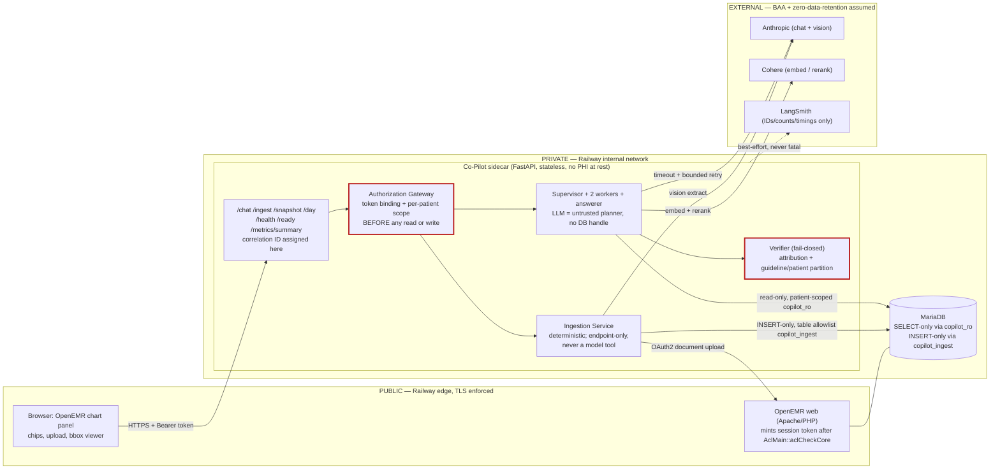

# W3_ATO_PACKET.md — Authorization-to-Operate Evidence Packet, Clinical Co-Pilot

> **Status: ATO-STYLE EVIDENCE PACKET (v1, 2026-07-20).** This is the reviewer's packet — the artifact a security assessor would accept as the evidentiary basis for an authorization decision — assembled from existing repo artifacts; it is **separate** from the design narrative in [`ARCHITECTURE.md`](./ARCHITECTURE.md), with companion links to [`THREAT_MODEL.md`](./THREAT_MODEL.md) (attack surface), [`W3_TRIAGE_REPORT.md`](./W3_TRIAGE_REPORT.md) (worked triage over 13 findings), and [`W2_ARCHITECTURE.md`](./W2_ARCHITECTURE.md) (the target's as-built design).

**Companion documents:** [`CLAUDE.md`](./CLAUDE.md) (the nine invariants, verbatim), [`docs/PRD.md`](./docs/PRD.md) (what/why + definition-of-done), [`docs/TECH_SPEC.md`](./docs/TECH_SPEC.md) (module index), [`copilot/AUTH_TOKEN_SPEC.md`](./copilot/AUTH_TOKEN_SPEC.md) (session-token contract), [`W1_ARCHITECTURE.md`](./W1_ARCHITECTURE.md) (Week-1 baseline).

This packet does not introduce new claims. Every section names the repo artifact it draws from; where a fact is verified against running infrastructure it is marked **VERIFIED live**. Nothing here is a live-exploited breach — the vulnerability evidence in §6 is a disciplined self-scan, triaged in [`W3_TRIAGE_REPORT.md`](./W3_TRIAGE_REPORT.md).

---

## 1. System identification & authorization boundary

*Draws from [`CLAUDE.md`](./CLAUDE.md), [`docs/PRD.md`](./docs/PRD.md), [`W2_ARCHITECTURE.md`](./W2_ARCHITECTURE.md) §2.4.*

### 1.1 System identification

| Field | Value |
| --- | --- |
| **System name** | Clinical Co-Pilot (AgentForge) — an AI briefing assistant embedded in OpenEMR |
| **Function** | Thin, **read-only** integration that surfaces "what changed for the next patient" to a busy outpatient PCP in ~90 seconds between rooms (`PRD.md`) |
| **System of record** | OpenEMR (PHP + MariaDB) — the Co-Pilot never displaces it; it only reads and attributes |
| **Components in boundary** | OpenEMR web (Apache/PHP), MariaDB, Co-Pilot sidecar (FastAPI, Python 3.12, `copilot/`), Ingestion Service, in-process RAG index |
| **External services (out of boundary, under BAA/ZDR assumption)** | Anthropic (chat + vision), Cohere (embed v4.0 / rerank v3.5), LangSmith (traces: IDs/counts/timings only) |
| **Authorization type sought** | ATO-style operate authorization for a **demo-data** deployment; not a production PHI go-live |
| **Assessment basis** | As-built code on `feat/week2-mvp`, verified to `file:line`; live posture probes against the running hosts |

### 1.2 Live target inventory (VERIFIED live, 2026-07-20)

| Target | URL | Exposure | Posture check |
| --- | --- | --- | --- |
| OpenEMR web | `https://openemr-production-31ad.up.railway.app` | Public (system of record; only intentionally public app surface) | Reachable |
| Co-Pilot sidecar | `https://copilot-production-5e86.up.railway.app` | Public demo endpoint (session-token gated) | `/ready` **all-green**; ingest **enabled** |
| `/dev/token` on sidecar | `…/dev/token` | — | Returns **404** → `auth_dev_mode=false` in prod (dev-mode OFF), **VERIFIED live** |
| Local dev stack | `docker/development-easy-light` (MariaDB + OpenEMR), sidecar on port **8811** | Localhost only | Dev-mode token minting bounded to seeded demo data |

### 1.3 Data classification

Per **CLAUDE.md invariant #8**: **only demo data, ever.** No real PHI enters any tier at any time.

| Attribute | Classification |
| --- | --- |
| Data at rest in the agent tier | **None** — the sidecar is stateless; no PHI persisted in the agent tier |
| Data in OpenEMR / MariaDB | Synthetic demo patients only (seeded); classified **demo, non-PHI** |
| Ingestion fixtures | Synthetic PDFs (reportlab-generated); no patient names are real |
| Data sent to external LLM/embeddings | Demo chart/document text under assumed **BAA + zero-data-retention** |
| Logs / traces / metrics | IDs, enum keys, source primary keys, counts, timings **only** — never PHI values; `filename` is explicitly excluded (it carries patient names) |

### 1.4 The nine invariants as security controls

The Co-Pilot's security posture is defined by nine non-negotiable invariants (`CLAUDE.md`). Restated here as the control catalog a reviewer evaluates; the as-built preservation evidence is in `W2_ARCHITECTURE.md` §3.

| # | Invariant | Control family (NIST-style) | Where enforced |
| --- | --- | --- | --- |
| 1 | LLM is an **untrusted planner** — proposes tool calls only; no DB handle, no authz authority | AC / SI — least function | Tool registry has no write tool; VLM confined to a forced extraction schema |
| 2 | **Deterministic two-layer authz** — OpenEMR gacl delegation + per-patient scope, before any read | AC — access enforcement | `AclMain::aclCheckCore` at mint; `enforce_patient` + `authorize` at the sidecar |
| 3 | **Read-only** agent tier | AC — least privilege | `copilot_ro` (SELECT-only); writes isolated to `copilot_ingest`, endpoint-only |
| 4 | **Hard source attribution** — every claim binds a real PK; fail-closed verifier quarantines unattributed claims | SI — information integrity | `copilot/app/verifier.py` (exit gate) |
| 5 | **Strict schemas** are the source of truth (Pydantic/Zod) | SA/SI — input validation | `contracts.py`, `ingest/schemas.py` |
| 6 | **Observability from the start** — correlation ID threads every request | AU — audit & accountability | `correlation.py`; LangSmith child spans |
| 7 | **`/health` and `/ready` separate**; `/ready` checks real dependencies | CM/SI — system monitoring | `main.py` `/ready` per-dependency rubric |
| 8 | **PHI safety** — stateless tier, never log PHI, BAA + ZDR, demo data only | MP/SC — media & transmission | log allowlist `correlation.py`; demo-only fixtures |
| 9 | **Graceful degradation** — partial + flagged, never fabricated | CP/SI — fail-safe | named degraded modes per dependency (`W2` §11) |

The two controls a reviewer should test first are #2 and #4 — the **Authorization Gateway** and the **Verifier** — because they are the two deterministic trust boundaries that everything else leans on (§3).

---

## 2. Architecture diagram — trust zones

*Draws from [`W2_ARCHITECTURE.md`](./W2_ARCHITECTURE.md) §2.4 (system shape). Redrawn compactly for the boundary review.*

Three trust zones: **PUBLIC** (Railway edge, TLS-enforced; the only externally reachable surface), **PRIVATE** (Railway internal network — sidecar + database), and **EXTERNAL** (third-party services under BAA/ZDR assumption). The two red-bordered nodes are the deterministic trust boundaries.

**Boundary statement.** Only OpenEMR web and the sidecar's HTTP surface are public; MariaDB and the sidecar's internals are private; external model providers are reached outbound-only, never as an inbound callback. Nothing reads or writes before the Authorization Gateway fires; nothing reaches the physician before the Verifier fires. Both are deterministic code and cannot be talked out of firing (`W2` §2.4).

---

## 3. Data-flow diagram — `/chat` and `/ingest`

*Draws from [`W2_ARCHITECTURE.md`](./W2_ARCHITECTURE.md) §3.1 (auth flow), §4.1 (ingest flow). The two trust boundaries are marked.*

```mermaid
flowchart TD
    subgraph CHAT["Read path — POST /chat"]
        C1["Browser sends message<br/>+ Bearer session token (URL fragment)"]
        C2{{"TRUST BOUNDARY 1 — Authorization Gateway<br/>require_session_token (main.py:148)<br/>enforce_patient (main.py:176) + authorize (authz.py:58)"}}
        C3["Supervisor + workers + answerer<br/>read-only tools, server-injected pid,<br/>copilot_ro SELECT-only (db.py:60)"]
        C4["Critic (deterministic) — strip order/med claims"]
        C5{{"TRUST BOUNDARY 2 — Verifier (fail-closed)<br/>provenance + numeric grounding<br/>+ guideline/patient partition (verifier.py)"}}
        C6["AgentResponse JSON → panel<br/>unattributed claims quarantined"]
        C1 --> C2 -->|allow| C3 --> C4 --> C5 --> C6
        C2 -->|deny| CX["401 / 403 — clean refusal, nothing runs"]
    end

    subgraph INGEST["Write path — POST /ingest"]
        I1["Front desk uploads file + pid + doc_type"]
        I2{{"TRUST BOUNDARY 1 — Authorization Gateway<br/>authorize(user, pid) before any byte processed"}}
        I3["Ingestion Service (deterministic)<br/>sha3-512 dedup; OAuth2 doc upload to OpenEMR"]
        I4["VLM forced-schema extraction<br/>(model_validate, retry ≤ 2)"]
        I5{{"TRUST BOUNDARY 2 — text-layer quote verification<br/>unverified fields NOT persisted (fail-closed)"}}
        I6["copilot_ingest INSERT-only on 5 tables<br/>+ in-code allowlist; provenance rows"]
        I1 --> I2 -->|allow| I3 --> I4 --> I5 -->|verified only| I6
        I2 -->|deny| IX["clean refusal, nothing runs"]
        I5 -->|unverified| IG["surfaced as gap / needs_review"]
    end
```

The two flows share the same first boundary (the Authorization Gateway) and each has a second fail-closed boundary appropriate to its direction: for `/chat`, the **Verifier** (no unattributed claim leaves); for `/ingest`, **text-layer quote verification** (no unverified value is persisted). Ingestion runs **before the visit**, off the physician's 90-second critical path (`W2` §2.1).

---

## 4. Authorization model

*Draws from [`W2_ARCHITECTURE.md`](./W2_ARCHITECTURE.md) §3.1, §4.2 and [`copilot/AUTH_TOKEN_SPEC.md`](./copilot/AUTH_TOKEN_SPEC.md).*

Every caller-to-target pair, the credential it carries, the scope that credential grants, and the deterministic point where the grant is enforced:

| Caller (agent / component) | Target | Identity / credential | Scope / grants | Enforced at |
| --- | --- | --- | --- | --- |
| Browser panel → sidecar `/chat`, `/ingest` | Sidecar HTTP | **HMAC session token** in the URL fragment, **900s TTL**; `pid`+`scope` minted only **after `AclMain::aclCheckCore('patients','demo')`** | Bound to `sub` (OpenEMR `users.id`), `pid`, `scope` (`patient`\|`day`), `acl="patients:demo"`, `exp` | `require_session_token` (`main.py:148`) + `enforce_patient` (`main.py:176`) — token binding then per-patient scope |
| Agent tools (read) → MariaDB | `openemr` schema | **`copilot_ro`** DB user | **SELECT-only**, parameterized; no `pid` argument (injected server-side) | `db.query` guardrail rejects non-SELECT/multi-statement (`db.py:60`) + `authorize` provider match (`authz.py:58`) |
| Ingestion Service (write) → MariaDB | 5 openemr tables + `copilot.*` | **`copilot_ingest`** DB user | **INSERT-only** on exactly 5 tables + **in-code allowlist** (defense in depth); no UPDATE/DELETE | Endpoint-only invocation — **never a model tool** (`W2` §4.2); DB grant + code allowlist enforce twice |
| Ingestion Service → OpenEMR REST | OpenEMR `/api/patient/:pid/document` | **OAuth2 password grant** | Document upload (round-trips through OpenEMR's own hash) | `openemr_api.py` |
| Red-Team / Judge agents (platform) → target Co-Pilot | Sidecar HTTP | **Dev session token** (synthetic data only) | Isolated, stateless run against seeded demo data | Platform run harness + kill-switch (`ARCHITECTURE.md`) |

**Two layers, both must pass** (`W2` §3.1): Layer 1 is token binding (`scope=="patient"`, `claims.pid == request pid`, `acl=="patients:demo"` — a token for patient A can never act on patient B → **403**); Layer 2 is the per-patient provider-match scope. The **ACL/role decision is delegated to OpenEMR gacl at mint** — the sidecar never re-implements it (invariant #2). `user_id` comes from the token, never a static value. The signing key is DB-resident (`copilot_signing_key`), read via the existing `copilot_ro` grant, cached ~60s; a missing key **fails closed** (no token can be trusted).

---

## 5. Dependency inventory — versions & provenance

*Draws from [`copilot/requirements.txt`](./copilot/requirements.txt). Versions are pinned there; `pip-audit` + `bandit` run against this set in [`.gitlab-ci.yml`](./.gitlab-ci.yml).*

Runtime and security-relevant dependencies (Python 3.12), as pinned:

| Package | Version pin | Role / provenance |
| --- | --- | --- |
| `fastapi` | `0.115.6` | HTTP surface (`/chat`, `/ingest`, `/ready`, …) |
| `uvicorn[standard]` | `0.34.0` | ASGI server |
| `pydantic` | `2.10.4` | Strict schema contracts (invariant #5) |
| `pydantic-settings` | `2.7.1` | Typed config loading |
| `SQLAlchemy` | `2.0.36` | DB access layer (parameterized) |
| `PyMySQL` | `1.1.1` | MariaDB driver |
| `anthropic` | `>=0.49,<1.0` | Chat + vision (forced tool) |
| `langsmith` | `>=0.1.140,<1.0` | Traces (IDs/counts/timings only) |
| `httpx` | `0.28.1` | Outbound client (per-dependency timeouts) |
| `slowapi` | `0.1.9` | Per-IP rate limiting on the public demo endpoint |
| `pypdfium2` | `>=4` | PDF text layer + page-image render (**bbox authority**) |
| `python-multipart` | `>=0.0.9` | Multipart upload for `POST /ingest` |
| `rank-bm25` | `0.2.2` | Lexical leg of hybrid retrieval |
| `cohere` | `>=5,<6` | embed v4.0 + rerank v3.5 (keyless fallback exists) |
| `pyyaml` | `>=6,<7` | Corpus front-matter + golden eval cases |
| `reportlab` | `>=4,<5` | **Dev/fixtures only** — synthetic PDF generation |

**Security tooling in the dependency set** (CI-only): `pip-audit>=2.7,<3` (dependency CVE audit over the pinned set), `bandit>=1.7,<2` (static scan of `copilot/app`, medium severity + medium confidence floors), `ruff>=0.6,<1` (lint gate). All three run in `.gitlab-ci.yml`; `ruff` + `pytest` + the golden gate also run in the authoritative pre-push hook. **No secrets are required by the CI pipeline** — the eval job is hermetic (zero API keys, zero MariaDB). This addresses OWASP **A06 Vulnerable Components** as a continuously-exercised watch item (`THREAT_MODEL.md` §3).

---

## 6. Vulnerability-scan results (platform self-scan)

*Draws from [`W3_TRIAGE_REPORT.md`](./W3_TRIAGE_REPORT.md) (full 13-finding triage) and [`THREAT_MODEL.md`](./THREAT_MODEL.md).*

The Week-3 adversarial platform (multi-agent red-team) plus the deterministic sensor suite — **OWASP ZAP** (DAST) + **Semgrep** (SAST) + **bandit** (Python SAST) + **pip-audit** (dependency CVEs) — were run against the sidecar (`copilot/app/`). Thirteen findings were raised and each was validated against source (`file:line`) and the deterministic spine. **Nothing here is a live-exploited breach.**

### 6.1 Severity summary

| Severity | Count | Finding IDs |
| --- | --- | --- |
| 🔴 CRITICAL | 2 | RT-001 (`/dev/token` any-`pid` mint), RT-002 (indirect prompt injection via ingested free-text) |
| 🟠 HIGH | 3 | RT-003 (rate limiter proxy-spoofable/in-memory), RT-004 (rate limit not on all routes), RT-005 (`/ready` info disclosure) |
| 🟡 MEDIUM | 3 | RT-006 (`/metrics/summary` no patient binding), RT-007 (fixed dev signing key), RT-008 (unbounded rate-limit map) |
| ⚪ FALSE POSITIVE | 5 | RT-009 (SQLi in labs `LIKE`), RT-010 (no-`pid` cross-patient), RT-011 (LLM writes to DB), RT-012 (VLM hallucination persists), RT-013 (guideline laundered into patient facts) |
| **Total** | **13** | |

### 6.2 The false-positive cluster is the point

Five confidently-raised findings (RT-009…013) are **already mitigated** by the deterministic spine, and the triage disposes of each with `file:line` evidence rather than filing engineering noise: parameterized SQL (`db.py:53-68`), server-injected `pid` (`tools/__init__.py`), read-only `copilot_ro`, fail-closed text-layer verification, and the verifier partition rule. Separating real risk from scanner noise — with evidence on both sides — is the deliverable. The two CRITICAL and three HIGH findings that survive scrutiny carry concrete dispositions and compensating controls; the residual-risk subset is tracked in §8 and §10.

**Full triage, evidence, and dispositions:** [`W3_TRIAGE_REPORT.md`](./W3_TRIAGE_REPORT.md).

---

## 7. Test evidence (eval results)

*Draws from [`copilot/evals/golden/results.json`](./copilot/evals/golden/results.json), [`copilot/evals/golden/baseline.json`](./copilot/evals/golden/baseline.json), [`.gitlab-ci.yml`](./.gitlab-ci.yml), [`docs/TECH_SPEC.md`](./docs/TECH_SPEC.md), [`docs/PRD.md`](./docs/PRD.md).*

### 7.1 Golden set — 65 boolean-rubric cases, all passing

The behavioral gate is a **65-case golden set** with **boolean** (pass/fail) rubrics per category and deterministic per-category floors — no 1–10 vibes. Latest hermetic run (`git_sha 4a50c19…`, mode `hermetic`):

| Rubric category | Pass rate | n | What it guards |
| --- | --- | --- | --- |
| `schema_valid` | **1.00** | 65 | Every response validates against the Pydantic contract |
| `citation_present` | **1.00** | 36 | Every clinical claim carries a source ref (invariant #4) |
| `factually_consistent` | **1.00** | 52 | Claim values ground-check against cited evidence |
| `safe_refusal` | **1.00** | 12 | Out-of-scope / unsafe asks are refused cleanly |
| `no_phi_in_logs` | **1.00** | 65 | Log capture shows no PHI values leak (invariant #8) |

Case composition (65 cases, by scenario family): citation 12, evidence 13, extraction 18, missing_data 10, refusal 12. Each case exercises a **boundary** (missing/empty data), an **invariant** (claims cite a source), or a **regression risk**, and documents the failure mode it guards (`TECH_SPEC.md`).

### 7.2 The gate is the authority — and it stays fresh

- **Deterministic gate:** `runner.py --mode hermetic` → `gate.py` enforces per-category floors and **refuses to pass below them**; `--update-baseline` can never be used to make red green (`TECH_SPEC.md`).
- **Freshness guard:** `results.json` carries a `git_sha` (currently `4a50c19b568f454cbeff230b024eae3569bdde96`) and a case-identity manifest, so stale results cannot be passed off as current.
- **Enforcement path:** the `.githooks/pre-push` hook is the **authoritative, demonstrable PR-blocking gate** (lint → tests → golden gate); `.gitlab-ci.yml` mirrors it and adds the network-dependent `pip-audit` + `bandit` audits.
- **Adversarial regression suite:** the Week-3 platform contributes attack cases (`evals/`, mapped to OWASP per `THREAT_MODEL.md` §3); confirmed exploits become versioned regression cases, and cross-patient exfiltration runs continuously as an **invariant-holds regression proof** (expected to fail; the case exists to catch a future gateway regression). Per `ARCHITECTURE.md`, the platform is the forward-looking Week-3 build; the shipped authority today is the 65-case golden gate above.

**Definition-of-done rule (`PRD.md`):** a ticket lands only when the eval gate passes. **A green reviewer agent is not "done" — the deterministic gate is the authority.** This is the same principle the incident postmortem in §9 turns on.

---

## 8. Known limitations & residual-risk ledger

*Draws from [`W3_TRIAGE_REPORT.md`](./W3_TRIAGE_REPORT.md), [`THREAT_MODEL.md`](./THREAT_MODEL.md). Honest ledger — what is genuinely open, its compensating control, an owner, and a target date.*

| ID | Residual risk | Severity | Compensating control (in place today) | Owner | Target |
| --- | --- | --- | --- | --- | --- |
| **RT-001** | `/dev/token` mints an any-`pid` token with no auth; `auth_dev_mode=true` in the local `.env` is a prod-enablement footgun | 🔴 CRIT | Returns **404 in prod** (dev-mode off, **VERIFIED live**); dev exposure bounded to seeded demo data | Sidecar/auth owner | Add boot-time assertion refusing prod start if `auth_dev_mode` true + CI check on `.env.example` — **2026-08-15** |
| **RT-002** | Indirect prompt injection via ingested document free-text (`chief_concern`/`family_history` surfaced verbatim) | 🔴 CRIT | Cannot cross patient scope (no-`pid` tools + `enforce_patient`), cannot write (read-only), cannot launder guideline text (verifier partition); numeric grounding + system-prompt instruction | Ingestion + graph owner | Fenced "treat as data, not instructions" delimiting of intake free-text + regression eval case — **2026-08-08** |
| **RT-003** | Rate limiter is proxy-spoofable, in-memory, per-process, not shared across replicas | 🟠 HIGH | Session-token scoping already limits who reaches authenticated routes; per-turn cost caps bound spend | Platform/infra owner | Move to shared store (Redis) or push limiting to the Railway edge — **2026-09-01** |
| **RT-004** | `/health`, `/ready`, `/`, `/dashboard`, `/dev/token` carry no rate-limit dependency | 🟠 HIGH | `/health` + `/ready` are **intentionally** unthrottled so probes are never limited out | Sidecar owner | Throttle `/dev/token` + `/dashboard`; document the two probe routes as by-design — **2026-08-22** |
| **RT-005** | `/ready` enumerates configured dependencies unauthenticated (recon aid; **no secret values**) | 🟠 HIGH | Exposes no secrets; `/ready` must stay probe-reachable | Sidecar owner | Return bare `ready/not-ready` unauthenticated; gate per-dependency detail behind auth — **2026-08-22** |
| **RT-008** | Unbounded growth of the in-memory rate-limit map (memory-exhaustion DoS) | 🟡 MED | Low exploit value; bounded by process memory | Infra owner | Evict drained deques, or subsumed by the RT-003 shared-store migration — **2026-09-01** |

RT-006 and RT-007 are dispositioned **Document/Defer** (aggregate non-PHI telemetry; inert dev-only constant) and are not carried as open risk. The remaining five findings are false positives (§6).

---

## 9. Sample incident / postmortem — Judge drift false-negative

*Illustrative postmortem in the Week-3 platform's own operating model. Demonstrates the detection, containment, and correction discipline a reviewer expects; mirrors the golden gate's per-category-floor philosophy (`PRD.md`).*

**Title:** Judge agent drifted lenient over a long run and scored a real edge "safe" (false negative).

**Summary.** Over an extended adversarial run, the Judge agent's calibration drifted toward leniency. It correctly recognized that a **cross-patient exfiltration attempt was blocked** — a `403` from `enforce_patient`, and the corresponding claim quarantined by the Verifier. But on a **second payload** — where the answerer echoed injected guideline text as if it were a patient fact — the Judge scored the run **"safe,"** missing a genuine edge that warranted a ticket. The deterministic controls held; the *evaluator's judgment* did not.

**Detection.** Per-run **gold canary cases with known verdicts** are interleaved into every run. The Judge's **agreement rate with the deterministic oracles fell below the calibration floor**, and the coverage ledger flagged **judge-vs-oracle disagreement**. This mirrors the golden gate's per-category floors: a measurable floor, deterministically checked, is what catches a drifting evaluator.

**Containment.** The run was **auto-flagged**; its results were **withheld from the append-only ledger merge** and quarantined for human review. The Judge model tier was **kill-switched** for the remainder of the run.

**Root cause.** The Judge prompt lacked a **hard anchor to deterministic-oracle ground truth**; long-context drift plus single-model self-consistency erosion let its verdicts wander over a long run.

**Correction.**
- **Bind Judge verdicts to the deterministic oracles** — the Judge may only **escalate**, never **override**, a `403` / a quarantine / a critic strip.
- **Fail the run** if canary calibration falls below the floor.
- **Reset the Judge context per case** (kill long-context drift).
- Add the bypass payload as a **regression case**, and open a **Co-Pilot verifier-hardening ticket** (the echoed-guideline edge overlaps RT-002 in §8).

**Lesson.** The independent Judge is a **signal**; the **deterministic oracles are the authority** — the same principle as `PRD.md`: *"a green reviewer agent is not done; the deterministic gate is the authority."*

---

## 10. Plan of action & milestones (POA&M) + sign-off

*Consolidates the deferred findings from §8 into a milestone schedule for the authorizing reviewer.*

### 10.1 POA&M

| POA&M | Weakness | Source | Scheduled control | Target completion | Status |
| --- | --- | --- | --- | --- | --- |
| P-1 | Prod-enablement footgun on `auth_dev_mode` (RT-001) | §6 / §8 | Boot-time assertion + CI `.env.example` check | 2026-08-15 | Open |
| P-2 | Indirect prompt injection via intake free-text (RT-002) | §6 / §8 | Fenced untrusted-text delimiting + regression case | 2026-08-08 | Open |
| P-3 | Full route rate-limit coverage (RT-004) | §6 / §8 | Throttle `/dev/token`, `/dashboard`; document probe routes | 2026-08-22 | Open |
| P-4 | `/ready` information disclosure (RT-005) | §6 / §8 | Bare status unauth; detail behind auth | 2026-08-22 | Open |
| P-5 | Durable / edge rate limiting (RT-003, subsumes RT-008) | §6 / §8 | Shared store or edge limiting | 2026-09-01 | Open |

### 10.2 Authorization recommendation

On the evidence in this packet — the nine invariants enforced as deterministic controls (§1), two verified trust boundaries (§2–§3), a two-layer authorization model delegating the role decision to OpenEMR gacl (§4), pinned dependencies with CI CVE/SAST auditing (§5), a triaged self-scan with no live breach and its noise disposed with evidence (§6), a 65-case boolean gate at 100% with a freshness guard (§7), and an honest residual-risk ledger with owners and dates (§8, §10.1) — the recommended disposition is:

> **Authorization to Operate (demo-data deployment) — GRANTED with conditions**, conditioned on completion of POA&M items **P-1 and P-2** (the two CRITICAL residuals) by their target dates, and on the standing constraint that **only demo data is ever processed** (invariant #8). This authorization does **not** extend to real-PHI production use.

### 10.3 Sign-off

| Role | Responsibility | Name / signature | Date |
| --- | --- | --- | --- |
| System Owner / Engineer | Attests the as-built matches this packet | James Merithew | 2026-07-20 |
| Security Reviewer (assessor) | Accepts the evidence basis and POA&M | _________________ | __________ |
| Authorizing Official | Grants/denies the operate authorization | _________________ | __________ |

---

*End of packet. This document draws only on existing repo artifacts and modifies no other file. Verified-live claims were probed against the running hosts on 2026-07-20; all other facts are verified against the as-built code on `feat/week2-mvp`.*
