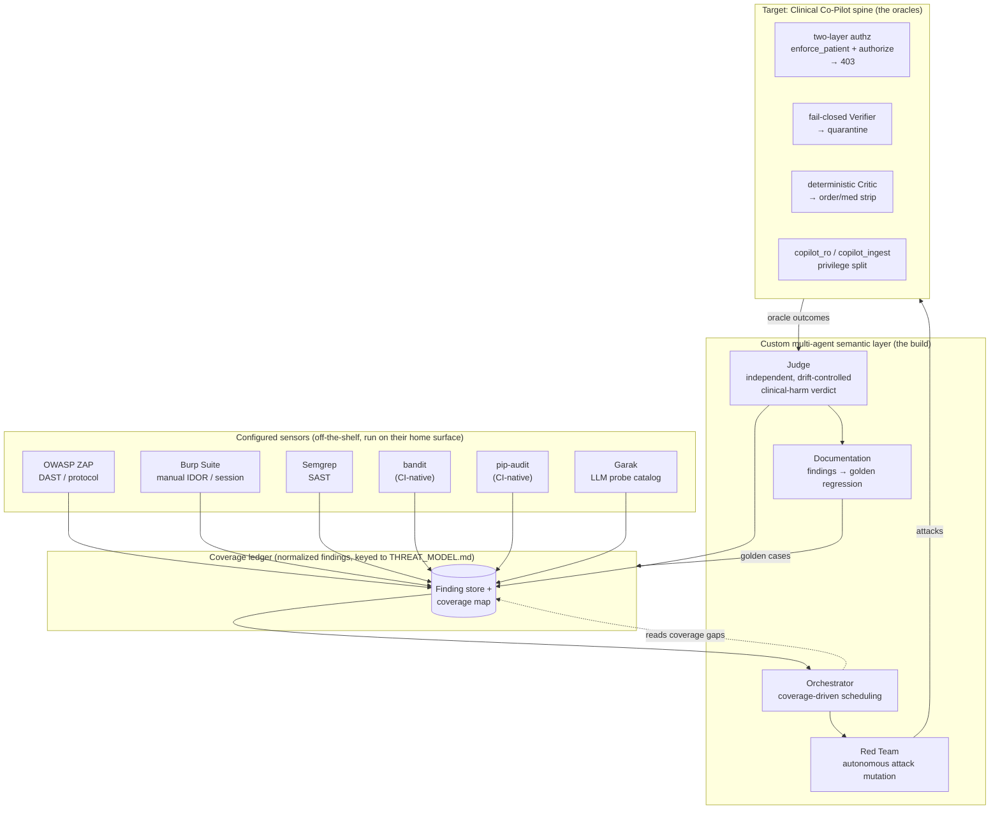

# W3_BUILD_VS_CONFIGURE.md — Week 3: Build-vs-Configure Decision Record

> **Status: DECISION RECORD (v1, 2026-07-20).** This is the pre-implementation defense for Week 3's multi-agent adversarial security platform: we justify *what we build and what we merely configure* **before** writing a single agent role, so the four custom agents (Orchestrator, Red Team, Judge, Documentation) exist only where nothing off-the-shelf covers the surface.
>
> **Companion documents:** [`ARCHITECTURE.md`](./ARCHITECTURE.md) (system-of-record design), [`THREAT_MODEL.md`](./THREAT_MODEL.md) (the healthcare-specific attack surface this platform must cover), [`CLAUDE.md`](./CLAUDE.md) (the nine non-negotiable invariants the co-pilot — our target — is built to uphold).

---

## 1. The decision in one sentence

**Build-AND-configure, not build-vs-configure absolutism.** We do **not** reinvent web scanners, protocol fuzzers, SAST engines, or LLM probe catalogs — we **configure them as sensors** that feed a shared coverage ledger. We **build only** the semantic layer that nothing off-the-shelf provides: autonomous attack mutation against a moving target, an independent drift-controlled judge, coverage-driven orchestration against a healthcare threat model, and binding to the co-pilot's own custom oracle semantics.

The rest of this document shows the work behind that sentence: why the target under-fits generic tooling (§3), the criteria we judge tools against (§4), the tool-by-tool comparison (§5), the honest finding (§6), the combined architecture (§7), and what we knowingly give up by building (§8).

---

## 2. Why this record exists

"Just use an off-the-shelf red-team tool" is the first question any reviewing CTO asks, and it is the right question. A custom multi-agent build is expensive to write and expensive to maintain; it forfeits a vendor SLA and external validation. So the burden of proof is on *us* to show the gap is real and not-invented-here. This record discharges that burden **before** we write agent roles, so the build is scoped to the gap and nothing more.

---

## 3. The target is unusual — why generic tooling under-fits

The thing we are attacking is not a web app with an LLM feature bolted on. It is an **autonomous LLM planner wrapped in a deterministic spine.** The LLM proposes tool calls; a deterministic control plane decides whether any of it is allowed to reach a physician. That inverts where the risk lives: the classic OWASP-web surface is genuinely small (a read-only FastAPI sidecar with a handful of typed endpoints), while the **novel** surface is *semantic* — it lives in language, not in packets.

The deterministic spine that a generic scanner is blind to:

| Spine component | Where | What it enforces | Why a generic scanner can't test it |
| --- | --- | --- | --- |
| **Two-layer authorization gateway** | `enforce_patient` (`copilot/app/main.py:176`) → `authorize` (`copilot/app/authz.py:58`) | gacl role/category decision **composed with** per-patient (user↔patient) scope; a `403` before any read | Requires reasoning about *runtime authz composition* — that the ACL says "yes, can read labs" but the scope layer says "no, not *this* patient". A DAST tool sees a 403 and moves on; it cannot tell a correct scope denial from a lucky one |
| **Fail-closed Verifier** | exit gate on every response | Every factual claim must bind to a real primary key; unattributed claims are **quarantined**, never shown as fact | The failure mode is *semantic*: a fabricated but plausible clinical claim. No protocol fuzzer has a notion of "this sentence is unsourced" |
| **Always-on deterministic Critic** | post-generation, every turn | Strips order-like / prescriptive medication language before egress (read-only invariant, CLAUDE.md #3) | Requires understanding clinical intent in free text — "start metformin 500mg" is dangerous, "the chart lists metformin" is fine |
| **Privilege-split DB roles** | `copilot_ro` (read-only) + `copilot_ingest` (INSERT-only) | The agent tier physically cannot mutate the record of truth | A black-box scanner never sees the DB grant; it can only infer it by failing to write, which read-only endpoints already prevent |
| **`pid`-free tool schemas** | `copilot/app/tools/__init__.py` | Tools take no patient id — the gateway injects the authorized scope, so the LLM planner *cannot* address another patient | The attack ("make the planner read patient B while acting for patient A") is a *prompt-injection / scope-confusion* attack, not an IDOR on a URL parameter |

The attack surface is therefore **semantic**: prompt injection through ingested documents, **judge laundering** (persuading an evaluator that a harmful answer is safe), **cross-patient scope confusion**, medication/order-language leakage, and fabricated-but-cited claims. These are attacks *in language against an autonomous agent*, and they are exactly the class of defect a packet-level or code-level tool is structurally unable to generate or grade.

That is the whole thesis: **the deterministic OWASP-web/protocol/SAST surface is real and we will scan it — but it is the small surface. The large, novel surface is semantic, and it is what the custom build targets.**

---

## 4. Evaluation criteria

The criteria are not generic security-tool criteria; they are **derived from the co-pilot's own invariants** (CLAUDE.md). A tool earns its place only if it helps prove one of these holds under adversarial pressure:

| # | Criterion (traces to CLAUDE.md invariant) | What a qualifying tool must do |
| --- | --- | --- |
| C1 | **Untrusted planner** (#1) | Generate attacks that treat the LLM as an adversary proposing tool calls, not as a trusted component |
| C2 | **Deterministic two-layer authz** (#2) | Probe the *composition* of ACL + per-patient scope, including cross-patient confusion — not just endpoint auth |
| C3 | **Read-only** (#3) | Confirm no mutation/order path exists even under injection; understand order/med *language*, not just HTTP verbs |
| C4 | **Hard source attribution / fail-closed verifier** (#4) | Detect fabricated-but-plausible clinical claims and confirm the verifier quarantines them |
| C5 | **Strict typed schemas** (#5) | Attack within and around the Pydantic/`pid`-free contracts |
| C6 | **Observability + coverage** (#6) | Emit findings that thread a correlation id and roll up into a coverage ledger against the threat model |
| C7 | **PHI safety / demo-data-only** (#8) | Never exfiltrate patient-context payloads to a third party; operate on demo/synthetic data only |
| C8 | **Independent, drift-controlled judgment** | Grade clinical harm with a judge that is resistant to being talked out of a verdict (anti-laundering) |

A tool that fails **C7** is disqualified regardless of how well it scores elsewhere — that is a hard gate, not a weighting.

---

## 5. The comparison

Verdict vocabulary: **Configure-as-sensor** (run it on the surface it owns; pipe findings into the ledger) · **Seed corpus + regression** (mine it for attack seeds and freeze confirmed exploits as golden cases) · **Reference** (borrow building blocks / design patterns) · **Rejected (this use case)** (does not fit; may return later under constraints).

| Tool | Category | Home surface it owns (use it here) | Gap for an autonomous LLM-agent clinical target | Verdict |
| --- | --- | --- | --- | --- |
| **OWASP ZAP** | DAST / proxy | OWASP-web Top 10 + protocol fuzzing of the FastAPI surface; CI-scriptable against `copilot/openapi.json` | No LLM-planner semantics — no prompt-injection, no judge-drift, no per-patient scope reasoning | **Configure-as-sensor** |
| **Burp Suite** | DAST (manual) | Manual session-token replay, IDOR probing on `pid`, rate-limit-bypass exploration | Same LLM blind spot as ZAP; manual and human-paced, not autonomous | **Configure-as-sensor** (manual deep-dive) |
| **Semgrep** | SAST | Code-surface rules: non-`SELECT` SQL, missing authz dependency, secret-in-log | Static — cannot reason about *runtime* authz composition or injection-carried-in-data | **Configure-as-sensor** (complements CI `bandit`) |
| **NVIDIA Garak** | LLM vuln scanner | Catalog of known LLM probes (jailbreak, encoding, leakage) | Fixed catalog; no autonomous mutation; no clinical-harm judge; no coverage orchestration; unaware of the multi-agent target and its spine | **Seed corpus + regression** |
| **Microsoft PyRIT** | LLM red-team framework | Orchestration primitives, prompt converters, multi-turn scaffolding, scorers | A toolkit, not a running system; generic scorers; no binding to the co-pilot's verifier/critic/authz oracle; no coverage ledger tied to *this* threat model; no drift-controlled independent judge | **Reference** / building blocks |
| **promptfoo / Giskard** | Eval / ML-test | Assertion regression over fixed datasets | Not autonomous adversarial mutation; dataset-bound | **Seed corpus + regression** (turn each confirmed exploit into a golden case — mirrors `copilot/evals/golden/`) |
| **Commercial red-team SaaS** (Lakera, Robust Intelligence, Haize; HackerOne / Bugcrowd crowd) | Managed / crowd red-team | Breadth of attack library + external, third-party validation | **Data-governance disqualifier** (C7): sending patient-context payloads to a third party violates the BAA/ZDR + demo-data-only invariant (CLAUDE.md #8). Also black-box to the verifier/critic/authz internals that are the whole point; and cost | **Rejected (this use case)** — noted as *future* external validation on **synthetic data only** |

---

## 6. The honest finding

Three clean bands fall out of the table, and stating them plainly *is* the defense:

1. **Deterministic tools own the OWASP-web / protocol / SAST surface, and we should use them there.** ZAP, Burp, and Semgrep are better than anything we would write for their home surface, and that surface is real. We are already CI-native on this band — `bandit` and `pip-audit` run in `.gitlab-ci.yml` — and Week 3 adds ZAP/Semgrep as sensors, not replacements. Building our own web scanner would be exactly the not-invented-here waste this record exists to prevent.

2. **LLM-specific tools make excellent seed corpora and regression harnesses.** Garak's probe catalog and promptfoo/Giskard's assertion datasets are a running start for the Red Team agent's seed library, and the natural home for *frozen* exploits: every confirmed attack becomes a golden regression case (mirroring `copilot/evals/golden/`). PyRIT contributes converters and multi-turn scaffolding as reference building blocks.

3. **None of them provides the four-way combination this target requires.** The gap is not any single missing feature; it is the *conjunction*:

   - **(a) Autonomous mutation** of attacks against a **moving target** — the co-pilot changes across weeks; a fixed catalog goes stale, a human-paced tool does not scale.
   - **(b) An independent, drift-controlled judge** of *clinical* harm that resists judge-laundering — generic scorers have no notion of clinical harm and no anti-drift discipline.
   - **(c) Coverage-driven orchestration** against a **healthcare-specific threat model** (`THREAT_MODEL.md`) — so we can say *what fraction of the modeled attack surface has been exercised*, not just "we ran some probes".
   - **(d) Binding to the co-pilot's custom oracle semantics** — the `403` from the two-layer authz gateway, the verifier's fail-closed quarantine, the critic's order/med-stripping, and the read-only/INSERT-only DB split. An attack only "succeeds" or "fails" relative to *these* oracles, and no off-the-shelf tool knows they exist.

**That four-way gap — (a)+(b)+(c)+(d) — is precisely, and only, what the custom multi-agent build covers.** Everything outside it is configured, not built.

---

## 7. The build-AND-configure architecture

Off-the-shelf scanners run as **sensors**. Each normalizes its output into a common finding shape and emits it into the platform's **coverage ledger**, keyed to the threat model. The four custom agents sit **on top** as the semantic layer — they consume sensor findings, generate and mutate semantic attacks the sensors cannot, grade clinical harm, and drive coverage toward the modeled surface.

The line to defend: **sensors cover the protocol/code surface; the custom agents cover the semantic surface; the ledger is the single place we can point to and say how much of the modeled threat surface has actually been exercised.** No sensor is reimplemented, and no custom code is written where a sensor already covers the surface.

---

## 8. Tradeoff ledger

Building the semantic layer is not free. Stating the costs honestly is part of the defense.

| What we give up by building | Severity | Mitigation |
| --- | --- | --- |
| **Maintenance burden** — the custom agents are ours to keep working as the co-pilot evolves | Medium | Scope is bounded to the four-way gap (§6); everything else is a configured sensor we do not maintain. Confirmed exploits freeze into a regression harness so drift is caught, not re-discovered |
| **No vendor SLA / support** | Low–Medium | The sensor band (ZAP/Semgrep/bandit/pip-audit) *does* carry community/vendor support and covers the highest-volume, most-commoditized surface |
| **No external, third-party validation** | Medium | Explicitly deferred, not dismissed: a future third-party pen-test on **synthetic data only** (see Rejected below) provides the outside eyes, once we have a synthetic-data harness that satisfies C7 |
| **Risk of grading our own homework** | Medium–High | The Judge is designed independent and drift-controlled precisely to resist this; findings are reproducible golden cases, not judgment calls, so a reviewer can re-run them |

**Rejected alternatives:**

- **Rejected: pure-Garak.** A fixed probe catalog with no autonomous mutation, no clinical-harm judge, and no coverage orchestration — it goes stale against a moving target and cannot grade the harm that matters here. *Kept as a seed corpus, not the platform.*
- **Rejected: pure-PyRIT.** A toolkit, not a running system; its generic scorers do not bind to the co-pilot's verifier/critic/authz oracles, and it has no coverage ledger tied to our threat model. *Kept as reference building blocks (converters, multi-turn scaffolding).*
- **Rejected: commercial red-team SaaS / bug-bounty crowd (this use case).** Hard-gated by C7 — routing patient-context payloads to a third party violates the BAA/ZDR + demo-data-only invariant (CLAUDE.md #8); additionally black-box to the internal oracles that are the entire point, and costly. *Revisit only as future external validation on synthetic data.*

---

*This record is the gate: no Week-3 agent role is written for a surface a configured sensor already owns. The build is scoped to the four-way semantic gap, and nowhere else.*
