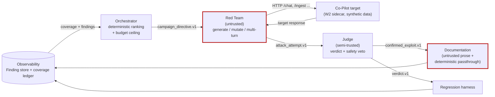

# W3_EVIDENCE_PACKET.md — Adversarial Security Platform, Week 3: One-Page Defense Reference

> **Status: EVIDENCE PACKET (v1, 2026-07-20) — consolidated defense reference.**
>
> **How to use this page:** it is a single-sitting map of the four-agent red-team platform — the interaction diagram, where each message schema lives, the trust boundaries, and the known failure modes. It **points to** the authoritative detail rather than duplicating it: the full agent design lives in [`ARCHITECTURE.md`](./ARCHITECTURE.md) §4, the versioned message contracts in [`contracts/`](./contracts), the target Co-Pilot's own guarantees in [`W2_ARCHITECTURE.md`](./W2_ARCHITECTURE.md), and the threat catalogue in [`THREAT_MODEL.md`](./THREAT_MODEL.md). Where a claim is enforced in code, the `copilot/` file is cited so a defender can verify it directly.

---

## 1. The platform in one sentence

Four agents run a closed-loop, budget-bounded campaign that red-teams the read-only OpenEMR Clinical Co-Pilot (the W2 FastAPI sidecar in `copilot/`): the **Orchestrator** ranks and dispatches campaigns, the **Red Team** (fully untrusted) generates and mutates multi-turn attacks against the live target, the **Judge** (semi-trusted) renders an independent verdict backed by a *computed, not voted* deterministic safety veto, and the **Documentation** agent turns confirmed exploits into findings. Every transition carries a `correlation_id` and fans out to three Handoff sinks, reusing the co-pilot's own [`copilot/app/graph/handoff.py`](./copilot/app/graph/handoff.py).

---

## 2. Agent interaction diagram

Each edge above is a **versioned message contract** (§3), and each transition emits a `correlation_id` that threads the whole run and fans out to the three Handoff sinks — `log_event` (enum/ID fields only), a LangSmith child run, and `response.handoffs` — exactly as the co-pilot's turn graph does today ([`copilot/app/graph/handoff.py:5`](./copilot/app/graph/handoff.py) documents the three sinks). The loop closes when Documentation + verdicts land in the Finding store, Observability rolls them into the coverage ledger, and the Orchestrator reads that ledger to pick the next campaign. The full node-by-node design, prompts, and model tiers are in [`ARCHITECTURE.md`](./ARCHITECTURE.md) §4 — this diagram is the map, not the territory.

---

## 3. Message schemas — pointer table

The four contracts are versioned JSON Schema under [`contracts/`](./contracts). Do not inline them; reference by file.

| Schema | Contract file | Producer → Consumer | Purpose (one line) |
| --- | --- | --- | --- |
| `campaign_directive.v1` | [`contracts/campaign_directive.v1.json`](./contracts/campaign_directive.v1.json) | Orchestrator → Red Team | Dispatch a scoped campaign: target surface, threat cells to cover, budget ceiling, deadline |
| `attack_attempt.v1` | [`contracts/attack_attempt.v1.json`](./contracts/attack_attempt.v1.json) | Red Team → Judge | One attempt: payload(s), multi-turn transcript, target response, self-reported intent |
| `confirmed_exploit.v1` | [`contracts/confirmed_exploit.v1.json`](./contracts/confirmed_exploit.v1.json) | Judge → Documentation | A verified success: what broke, the oracle signal, reproduction handle |
| `verdict.v1` | [`contracts/verdict.v1.json`](./contracts/verdict.v1.json) | Judge → Regression harness | Per-attempt success/fail/partial + computed safety veto, for the regression gate |

---

## 4. Trust boundaries

Two boundaries are inherited from the **target** Co-Pilot ([`W2_ARCHITECTURE.md`](./W2_ARCHITECTURE.md) §2.4); two are the **platform's own**. All four sit in deterministic code and cannot be talked out of firing.

| Boundary | What it separates | Enforced by |
| --- | --- | --- |
| Authorization Gateway (target) | Any read/write from an un-scoped caller | Deterministic user↔patient scope before every access — a 403 from `enforce_patient` ([`copilot/app/main.py`](./copilot/app/main.py)); W2 §2.4 |
| Verifier (target) | Fabricated claims from the physician's briefing | Fail-closed attribution + guideline/patient partition at the exit gate; unattributed claims quarantined (W2 §2.4) |
| Red-Team output is untrusted data | Attacker-authored payloads from the platform's control plane | Payloads are quarantined evidence, never executed as instructions; run only against **synthetic demo data**, never real PHI (CLAUDE.md #8) |
| Judge verdicts are advisory | A model's opinion from ground truth | The deterministic oracles are authoritative — a 403 from `enforce_patient`, a Verifier quarantine, a Critic strip decide success; the Judge may escalate but never override them |

---

## 5. Known failure modes

The heart of the packet. Each row is a way the *platform* (not the target) can fail, and the deterministic control that catches it.

| Failure mode | Manifests as | Detection signal | Mitigation |
| --- | --- | --- | --- |
| **Red Team generates genuinely harmful content** | Real-world-harmful text, not just a co-pilot probe | Harm-taxonomy classifier flags the category | Target is synthetic demo data only; payloads stored as **quarantined evidence, never executed** against real PHI; harmful categories route to human review; run deadline + kill-switch bound blast radius |
| **Judge agrees with everything / drifts lenient** | Verdicts skew lenient over a long run | Gold-labeled **canary cases** with known verdicts injected every run; judge-vs-oracle disagreement crosses a floor | Judge is independent (different model/prompt, stateless per case); may escalate but **never overrides a deterministic oracle**; run **FAILS if canary calibration < floor**, mirroring the golden gate's per-category floors ([`copilot/evals/golden/judge_panel.py`](./copilot/evals/golden/judge_panel.py)) |
| **Orchestrator has no clear next priority** | Redundant / off-scope attacks; campaign never converges | Coverage ledger shows churn on already-covered cells | Coverage ledger keyed to the threat model; prioritize uncovered / previously-failed cells; **bounded route cap** mirroring the co-pilot's `supervisor_max_routes=4` ([`copilot/app/config.py:138`](./copilot/app/config.py)); explicit stop conditions |
| **Cascading failure across agents in one run** | One agent's bad output corrupts the next; runaway loop / cost | Deadline exceeded; iteration cap hit; `correlation_id` trace shows a loop | Reuse the co-pilot bounds — `worker_max_iters=3` ([`config.py:141`](./copilot/app/config.py)), `agent_max_tool_iters=6` ([`config.py:71`](./copilot/app/config.py)), 20s `request_deadline_s` ([`config.py:72`](./copilot/app/config.py)), `max_retries=1`; per-agent circuit breakers; stateless isolated runs; **append-only ledger** so one poisoned run cannot rewrite prior coverage |

---

## 6. Pointer footer

- [`W3_TRIAGE_REPORT.md`](./W3_TRIAGE_REPORT.md) — findings triage and severity ranking
- [`W3_ATO_PACKET.md`](./W3_ATO_PACKET.md) — authorization-to-operate evidence bundle
- [`W3_BUILD_VS_CONFIGURE.md`](./W3_BUILD_VS_CONFIGURE.md) — what was built vs. configured/reused
- [`THREAT_MODEL.md`](./THREAT_MODEL.md) — the threat catalogue the coverage ledger is keyed to
- [`ARCHITECTURE.md`](./ARCHITECTURE.md) §4 — full agent design | [`contracts/`](./contracts) — the four versioned schemas
