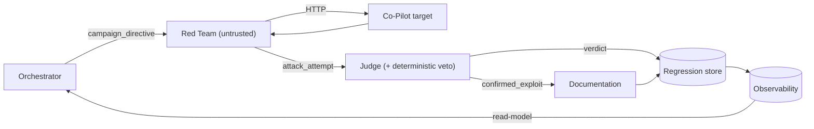

# Week 3 — Adversarial Security Platform · One-Pager

> **MVP milestone (updated 2026-07-21).** The multi-agent platform **ships as code**
> in [`redteam/`](../redteam) — four agents, deterministic invariants, versioned
> regression store, runner + gate, OWASP coverage, inter-agent contracts (incl. a typed
> error schema), and a **live proof + ≥3 full vulnerability reports against the deployed
> target**. This one-pager summarizes the threat model, the architecture, and the "why we
> chose this" justifications. See [`ARCHITECTURE.md`](../ARCHITECTURE.md)'s status table
> for the explicit shipped-in-MVP vs planned-for-Final split.

## What shipped (this milestone)

The **Architecture Defense package** — the plan for a multi-agent platform that
continuously red-teams the OpenEMR Clinical Co-Pilot, plus the design skeletons that
prove it is real (versioned message contracts, a validating attack-case schema, and
seed cases across all attack categories).

## Requirement → deliverable map

| Week-3 requirement | Deliverable | Status |
| --- | --- | --- |
| Stage 1 — target live & testable | [`W2_ARCHITECTURE.md`](../W2_ARCHITECTURE.md), [`DEPLOY.md`](../DEPLOY.md); prod verified live | ✅ existing |
| Stage 2 — threat model (6 categories, ~500-word summary, OWASP) | [`THREAT_MODEL.md`](../THREAT_MODEL.md) | ✅ new |
| Stage 4 — platform architecture (names each agent, diagram, ~500-word summary) | [`ARCHITECTURE.md`](../ARCHITECTURE.md) | ✅ new |
| Multi-agent system (Red Team, Judge, Orchestrator, Documentation) | `ARCHITECTURE.md` §3–§5 | ✅ designed |
| Regression & validation harness (pass-semantics) | `ARCHITECTURE.md` §9 | ✅ designed |
| Observability layer (Orchestrator substrate) | `ARCHITECTURE.md` §10 | ✅ designed |
| Inter-agent contracts (versioned JSON Schema) | [`contracts/`](../contracts) (4 schemas + CHANGELOG) | ✅ new |
| Attack suite (≥3 categories, OWASP-mapped, boundary/invariant/regression) | [`evals/`](../evals) — schema + 7 seed cases (all validate) | ✅ skeleton |
| OWASP Top 10 + LLM Top 10 mapping | `THREAT_MODEL.md` §3; required field in the case schema | ✅ new |
| Build-vs-configure decision record | [`W3_BUILD_VS_CONFIGURE.md`](../W3_BUILD_VS_CONFIGURE.md) | ✅ new |
| Evidence packet (diagram, schemas, trust boundaries, failure modes) | [`W3_EVIDENCE_PACKET.md`](../W3_EVIDENCE_PACKET.md) | ✅ new |
| Triage simulated scan (≥10 findings, crit/high/med/false-pos) | [`W3_TRIAGE_REPORT.md`](../W3_TRIAGE_REPORT.md) — 13 findings | ✅ new |
| ATO-style evidence packet | [`W3_ATO_PACKET.md`](../W3_ATO_PACKET.md) | ✅ new |
| AI-use disclosure + judge-drift detection | `ARCHITECTURE.md` §13 | ✅ new |

## The architecture in one paragraph

Four agents form a closed loop around the read-only Co-Pilot. The **Orchestrator**
(deterministic ranking + budget ceiling) reads an observability substrate and directs
the **Red Team** (fully untrusted; generates, mutates, and chains multi-turn attacks)
at the weakest category. Every attack becomes an `attack_attempt` for the **Judge**,
which renders an independent success/fail/partial verdict backed by a **deterministic
safety veto that is computed, not voted** (reusing `copilot/evals/golden/judge_panel.py`).
Confirmed exploits go to the **Documentation** agent (AI prose, deterministic facts,
human sign-off on critical). Agents never call each other directly — they pass
**versioned JSON-Schema messages** ([`contracts/`](../contracts)) over the Co-Pilot's
own typed handoff graph, so every transition is logged enum-only and inspectable.

## The gate story

"Done" is never a green agent — it is a deterministic gate, extending the Co-Pilot's
own rule (`docs/PRD.md`: "a green reviewer agent is not done; the deterministic gate
is the authority"). A case PASSES only when the **safe invariant held**, proven by a
deterministic check **and** the independent Judge across the attack's **mutation
family** — never because a specific payload string went absent. The case schema
enforces this structurally: a `model_validator` rejects any case that asserts no
invariant, so **a static payload list cannot even be authored** (verified — the
static-payload case is rejected at load). Severity-weighted floors (critical
categories at 1.00), a case-id manifest, and a `git_sha` freshness guard — the golden
gate's discipline — carry over so a fix that merely changes behavior, or a deleted
inconvenient case, can never turn the gate green.

## MVP shipped (all four agents + the loop)

The `redteam/` package is built and gated: **Red Team** (deterministic + Claude
generators behind a swappable Protocol), **Judge** (deterministic invariant veto,
escalate-only lenses), **Orchestrator** (deterministic ranking + budget), and
**Documentation** (reproducible reports, critical→human-gate), over deterministic
`invariants.py`, a versioned sqlite regression store, an HTTP runner (hermetic + live),
a severity-weighted gate, an OWASP coverage matrix, contract-conformance tests, and a
self-contained observability substrate. Wired into pre-push as `[5/6]` adversarial
runner + `[6/6]` adversarial gate — **golden 65-case gate stays green**. A **live proof**
lands a real finding on the deployed fork (`/ready` integration-map disclosure, RT-005)
and writes it to [`defense/week3/live_proof.md`](../defense/week3/live_proof.md).

## What's next (Final)

Orchestrator campaign depth + autonomous Documentation filing; sensor integration
(ZAP/Semgrep feeders); the local/OSS red-team model swap; the frozen golden-verdict-set
judge-drift job. All slotted behind the Protocol/store seams the MVP built.
